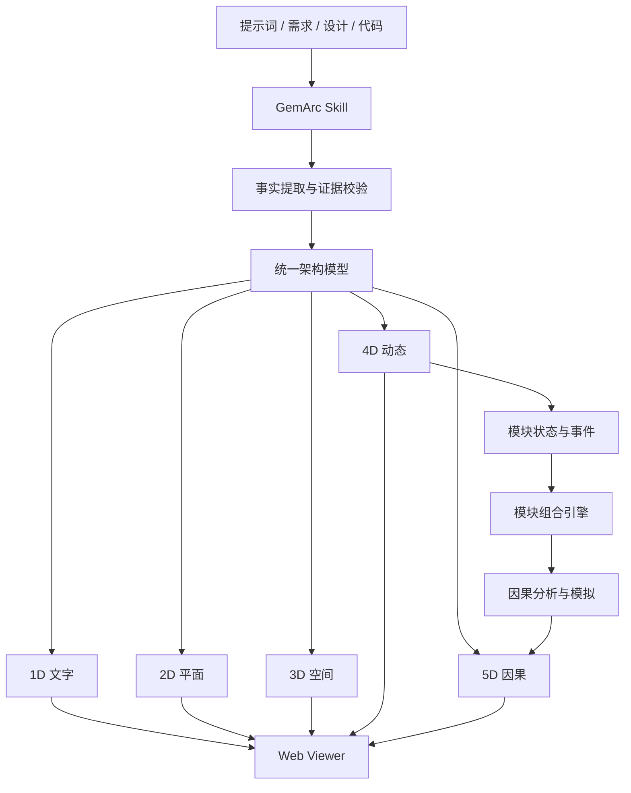

**本项目定义下的维度：统一主体，互不干涉。**

# GemArc

**GemArc — Causal Architecture Visualization**

**从静态架构到动态系统，从模块行为到组合因果。**

GemArc 是一个面向 AI Agent 的多维架构建模与可视化插件。它将提示词、需求、设计文档及代码中的架构事实转化为统一模型，通过 1D–5D 的递进表达，让用户不仅能够理解系统的组成与运行，还能探索多个动态模块组合之后产生的行为、依赖、反馈与因果结果。

默认语言为**简体中文（`zh-CN`）**，可通过 `--lang ja-JP` 或 `--lang en-US` 切换，并允许扩展语言字典。

GemArc 参考日本 IPA 相关资料与 ISO/IEC/IEEE 42010:2022 的架构描述原则，不宣称获得 IPA 官方认证，也不将 12 种 View 视为 IPA 强制标准。

---

## 1. 设计哲学

### 1.1 核心理念

**架构不是静止的组件集合，而是组件在约束下相互作用、随时间演化并产生结果的系统。**

传统架构图通常能够回答：

- 系统由什么组成？
- 组件之间如何连接？
- 组件部署在哪里？

GemArc 进一步尝试回答：

- 系统如何随时间运行？
- 多个模块组合后会发生什么？
- 哪个事件触发了哪个结果？
- 为什么出现这个结果，而不是另一个结果？
- 修改一个模块的条件后，其他模块会受到什么影响？

GemArc 将**结构、动态与因果**作为架构理解的三个关键层次。

### 1.2 同一主体原则

所有维度必须指向同一个架构主体。

从文字到二维图、三维图、动态三维图，再到因果系统，改变的是表达与分析能力，而不是架构事实本身。

统一架构模型是所有视图的事实来源。节点、关系、接口、约束、证据和标识符保持稳定。

不得通过切换维度创造不存在的组件、依赖或运行结果。

### 1.3 维度哲学

GemArc 使用一种面向架构认知的**表达层级模型**：

| 层级 | 表达形式 | 核心问题 | 新增能力 |
|---|---|---|---|
| 0D | 点 | 是否存在？ | 主体标识 |
| 1D | 文字 | 它是什么？ | 线性语义描述 |
| 2D | 平面图 | 如何组织？ | 平面结构与关系 |
| 3D | 空间图 | 如何分布？ | 空间层次与多轴分类 |
| 4D | 动态三维图 | 如何变化？ | 时间、状态与行为 |
| 5D | 因果动态系统 | 为什么发生？ | 模块组合、因果传播与反馈 |

这里的 D 是 GemArc 定义的表达层级标记，并不意味着所有层级都对应严格数学意义上的独立坐标。

其中，3D 空间加时间可以构成四维时空模型；5D 则是对动态模块组合所形成的因果结构的进一步建模。

**4D 让架构运行起来，5D 让架构解释为什么会发生。**

### 1.4 第五维：组合因果

第五维是 GemArc 的核心设计方向。

单个 4D 模块具有自身的状态、输入、输出和时间演化行为。多个模块通过明确的接口与约束组合，形成更高层次的系统行为。

例如：

```text
传感器模块
    │ 产生事件
    ▼
消息队列模块
    │ 转发事件
    ▼
规则引擎模块
    │ 满足触发条件
    ▼
告警模块
    │ 发送通知
    ▼
用户响应模块
```

二维图可以显示上述连接，三维图可以显示部署与信任边界，四维图可以显示事件传播过程。

**五维因果表达需要进一步解释：**

- 哪些条件共同导致告警？
- 消息延迟是否改变最终结果？
- 规则引擎失效会阻断哪些后续行为？
- 两个模块同时发生异常时，是否形成新的系统风险？
- 改变某个条件后，哪些结果会随之变化？

因此，GemArc 的第五维并非增加一条装饰性坐标轴，而是建立可追溯、可检查、可模拟的**组合因果模型**。

必须区分时间先后、统计相关与因果关系。仅凭两个事件依次发生，不能认定前者导致后者。

因果结论应具有明确依据，例如设计规则、状态转换定义、执行轨迹、测试结果或显式声明的因果假设。

---

## 2. 设计目标

GemArc 追求以下目标：

1. **统一事实**：所有表达形式共享同一架构模型。
2. **逐级增益**：升维必须提供不可由上一层直接观察的信息能力。
3. **动态组合**：模块能够根据接口、状态和约束组成可运行系统。
4. **因果可解释**：支持查看触发条件、传播路径、反馈环路及结果。
5. **证据可追溯**：架构事实和因果结论能够关联来源。
6. **可交互**：支持切换维度、时间、场景条件、模块组合及观察视角。
7. **可审查**：支持面向 IPA 相关资料及 ISO 42010 关注点的架构检查。
8. **可扩展**：通过 Plugin、Skill 和 Viewer 分离实现模块化扩展。
9. **可商用**：优先使用许可清晰、免费且允许商业使用的开源组件。
10. **信息优先**：视觉效果必须服务于信息传递，不以炫技代替设计质量。

---

## 3. 系统架构

GemArc 采用 **Plugin + Skill + Architecture Model + Three.js Viewer** 的组合。



### 3.1 Plugin

Plugin 负责安装、分发、版本管理及与 Agent 环境的集成。

它是功能交付边界，不直接承担架构事实推断。

### 3.2 Skill

Skill 负责：

- 从可信来源提取架构事实。
- 生成统一架构 JSON。
- 组织架构 View 与维度表达。
- 检查模型一致性、可追溯性和信息增益。
- 识别动态模块及其状态转换。
- 建立经过证据支持的因果规则。
- 输出可由 Viewer 消费的数据。

### 3.3 Three.js Viewer

Three.js 负责交互式三维表达，包括：

- 三维节点与关系。
- X/Y/Z 语义分类轴。
- 相机与投影模式。
- 动态模块状态。
- 事件与传播过程。
- 因果链高亮。
- 模块组合的交互探索。

Three.js 是渲染层，不应成为架构事实的唯一存储位置。

### 3.4 二维 Viewer

二维模式使用原生 SVG，无需 WebGL。

它与三维模式共享节点 ID、关系和分类轴。

X 轴可映射为纵向分层，Y 轴映射为横向泳道，Z 轴信息使用明确标注的包含关系表示。

空分类显示“无组件”，关系采用可读的正交连线。

二维和三维表达必须保持架构结论一致。

---

## 4. 五维因果模型

### 4.1 动态模块

每个动态模块应具有明确的：

- 唯一标识。
- 输入与输出。
- 状态集合。
- 状态转换规则。
- 触发条件。
- 时间相关行为。
- 外部依赖。
- 证据来源。

一个动态模块可以抽象为：

\[
M_i=(S_i,I_i,O_i,T_i,\delta_i)
\]

其中：

- \(S_i\)：模块状态集合。
- \(I_i\)：输入。
- \(O_i\)：输出。
- \(T_i\)：时间相关信息。
- \(\delta_i\)：状态转换函数或关系。

### 4.2 模块组合

多个模块组成系统：

\[
\mathcal{M}=\{M_1,M_2,\ldots,M_n\}
\]

模块之间通过明确的连接、约束和事件传播规则形成组合行为。

组合系统的行为不能简单地视为单个模块行为的视觉叠加。

GemArc 需要能够识别和呈现：

- 串行依赖。
- 并行执行。
- 条件触发。
- 资源竞争。
- 状态传播。
- 反馈环路。
- 故障传播。
- 恢复与补偿。

### 4.3 因果模型

因果分析可采用结构因果模型等形式化方法作为基础。

例如：

\[
Y=f(X_1,X_2,\ldots,X_n,U)
\]

其中 \(Y\) 是结果变量，\(X_i\) 是模型中的直接影响因素，\(U\) 表示未显式建模的外部因素。

对于存在循环依赖的系统，需要明确时间展开、状态转换或循环求解规则，不能直接假设普通无环因果图足以描述所有反馈行为。

GemArc 应区分三种结论：

| 类型 | 含义 |
|---|---|
| 已观测 | 来自执行日志、测试或监测证据 |
| 模型推导 | 根据已定义规则计算得到 |
| 假设模拟 | 基于用户提供或系统明确标记的假设 |

不得将假设模拟伪装为真实运行结果。

### 4.4 交互式因果探索

用户可以：

1. 选择多个动态模块。
2. 查看它们的输入、输出和组合关系。
3. 播放模块状态的时间演化。
4. 选择某个事件并追踪后续传播。
5. 修改允许调整的输入条件。
6. 对比不同条件下的模型结果。
7. 查看因果路径的证据与可信程度。

**目标不是让箭头动起来，而是让用户理解模块组合为什么产生特定结果。**

---

## 5. 架构 View 与维度的关系

**View 不等于维度。**

View 用于表达特定架构关注点，维度用于决定采用什么表达能力。

同一个 View 可以具有 2D、3D、4D 或 5D 表达。

例如：

| 架构 View | 3D | 4D | 5D |
|---|---|---|---|
| 逻辑 View | 模块层次 | 逻辑状态变化 | 逻辑依赖导致的结果 |
| 进程 View | 进程与通信 | 运行时事件 | 阻塞、竞争与故障传播 |
| 部署 View | 节点与网络 | 实例状态变化 | 故障影响与恢复路径 |
| 安全 View | 信任域与访问关系 | 认证与授权过程 | 攻击条件与风险传播 |
| 数据 View | 数据流与存储 | 数据生命周期 | 数据变化的下游影响 |

原有 12 种候选 View 可继续保留为可配置架构观察模板。

不要求每个 View 必须支持全部五个层级。缺少时间数据或因果规则时，应明确标注不支持相应能力。

---

## 6. 信息设计原则

GemArc 的视觉系统应遵循以下原则。

### 6.1 信息增益

每次升维必须带来明确的信息增益。

3D 不能只是将二维节点随机放到空间中。

4D 不能只是让静态节点旋转或漂浮。

5D 不能只是增加发光箭头、粒子或动画。

如果高维表达无法增加有效信息，应允许降级到更清晰的表达形式。

### 6.2 空间组织

- X/Y/Z 必须具有明确的分类含义。
- 计算逐级分类增益，折叠冗余轴。
- 默认每个 View 展示 6–18 个主要节点。
- 高密度系统通过子视图、聚合与按需展开管理。
- 长文本放入详情面板，不挤压空间标签。
- 提供透视、俯视、正视和侧视模式。
- 保持节点位置与关系路径的稳定性，避免无意义跳动。

### 6.3 时间表达

时间控制必须对应真实或明确标记的模拟状态。

支持暂停、播放、逐事件推进、时间定位及状态检查。

不得将动画播放速度等同于真实系统执行速度。

### 6.4 因果表达

- 以方向、连接与状态变化表达因果。
- 使用有限的颜色编码区分事件类型。
- 因果链能够被单独聚焦。
- 反馈环路必须清晰可辨。
- 非因果依赖与因果关系应有不同视觉语法。
- 不确定关系必须明确标记。
- 视觉动画必须可以关闭，核心信息仍应可读。

---

## 7. 安装

当前仓库的现有安装入口与插件清单仍使用 `ipa-architecture-3d` 标识。

**GemArc 是新的产品名称；以下命令保留现有仓库结构，避免品牌名称变更影响安装。**

### 7.1 Windows 一键安装

```powershell
git clone https://github.com/UlyssesLeoLee/AAArchitect.git
cd AAArchitect
powershell -ExecutionPolicy Bypass -File .\install.ps1
```

安装参数：

| 参数 | 作用 |
|---|---|
| `-Agents claude,codex,hermes,minimax` | 指定安装渠道 |
| `-Force` | 覆盖或生成相应插件包 |
| `-NoCli` | 不调用 Agent CLI |
| `-UserHome` | 指定用户目录 |
| `-HermesHome` | 指定 Hermes 目录 |
| `-PluginsRoot` | 指定插件根目录 |

安装程序会处理各 Agent 渠道，并在对应 CLI 不可用时使用支持的目录投递方式。

### 7.2 Claude Code

```powershell
claude plugin validate --strict .
claude plugin marketplace add .
claude plugin install ipa-architecture-3d@aaarchitect
claude plugin list
```

也可从远程仓库安装：

```powershell
claude plugin marketplace add UlyssesLeoLee/AAArchitect
claude plugin install ipa-architecture-3d@aaarchitect
```

临时加载：

```powershell
claude --plugin-dir "<仓库路径>"
```

### 7.3 Codex

将 Skill 安装至：

```text
~/.agents/skills/ipa-architecture-3d/
```

并按现有集成方式配置插件市场清单：

```powershell
Copy-Item .\integration-examples\codex-marketplace.json "$HOME\.agents\plugins\marketplace.json"
```

### 7.4 Hermes

现有 portable 插件目录：

```text
%LOCALAPPDATA%/hermes/plugins/ipa-architecture-3d/
```

Skill 目录：

```text
%LOCALAPPDATA%/hermes/skills/<分类>/ipa-architecture-3d/
```

本地插件验证：

```powershell
hermes plugins validate .
hermes plugins doctor .
```

远程安装：

```powershell
hermes plugins install https://github.com/UlyssesLeoLee/AAArchitect.git
```

对于安装安全扫描，应逐项核实扫描结果。不得为了绕过安全审查而直接关闭扫描，也不应把未经重新验证的扫描发现统一认定为误报。

### 7.5 MiniMax Code

```powershell
.\skills\ipa-architecture-3d\scripts\build_minimax_plugin.ps1
```

目标插件目录：

```text
%USERPROFILE%\.minimax\plugins\ipa-architecture-3d\
```

MiniMax 使用自身的 `.minimax-plugin/plugin.json` 格式，不能直接用根目录 portable 插件清单替代。

### 7.6 仅安装 Skill

```powershell
cd .\skills\ipa-architecture-3d

.\scripts\install_windows.ps1 `
    -Agents claude,codex,hermes,minimax
```

覆盖已有 Skill：

```powershell
.\scripts\install_windows.ps1 `
    -Agents claude,codex,hermes,minimax `
    -Force
```

macOS / Linux 可根据对应 Agent 的目录规范手动安装 Skill。Windows PowerShell 5.1 编辑脚本时应注意 UTF-8 BOM 兼容性。

---

## 8. 生成可交互架构网站

当前已有的 Three.js Viewer 位于：

```text
skills/ipa-architecture-3d/assets/viewer/
```

使用现有示例生成网站：

```powershell
cd .\skills\ipa-architecture-3d

python .\scripts\validate.py `
    .\assets\examples\illustrative-architecture.json

python .\scripts\build.py `
    .\assets\examples\illustrative-architecture.json `
    --out E:\gemarc-demo

cd E:\gemarc-demo

npm install
npm run test
npm run build
npm run dev
```

切换语言：

```powershell
python .\scripts\build.py `
    .\assets\examples\illustrative-architecture.json `
    --out E:\gemarc-ja `
    --lang ja-JP
```

构建产物位于 `dist/`，可用于静态网站部署。

现有生成命令主要对应当前架构 Viewer 能力。第五维所需的动态模块组合、因果引擎和模拟功能属于 GemArc 的目标架构，不能仅凭上述命令认定已经实现。

---

## 9. 数据模型扩展

GemArc 需要在统一架构事实模型上扩展动态与因果信息。

建议逻辑模型：

```text
Architecture
├── Identity
├── Evidence
├── Nodes
├── Edges
├── Interfaces
├── Constraints
├── Views
├── DynamicModels
│   ├── States
│   ├── Events
│   └── Transitions
├── Compositions
│   ├── Modules
│   ├── Connections
│   └── Rules
└── CausalModels
    ├── Variables
    ├── Dependencies
    ├── Assumptions
    ├── Interventions
    └── Outcomes
```

关键要求：

- 稳定 ID。
- 明确 Schema 版本。
- 架构事实与模拟假设分离。
- 因果规则可验证。
- 支持模型版本比较。
- 支持追溯来源。
- 不允许渲染层私自修改事实。
- 对缺失数据采用显式未知状态，不得补造结果。

---

## 10. 测试与质量

现有无需 npm 的验证命令：

```powershell
cd .\skills\ipa-architecture-3d

python -m unittest discover -s tests -v

node --test .\assets\viewer\tests\layout.test.mjs
```

GemArc 的质量验证应进一步覆盖：

| 测试领域 | 核心检查 |
|---|---|
| 事实一致性 | 各维度是否共享同一事实 |
| 结构正确性 | 节点、关系与分类是否有效 |
| 动态正确性 | 状态转换是否符合规则 |
| 组合正确性 | 接口、事件和依赖是否匹配 |
| 因果正确性 | 因果结论是否有模型或证据支持 |
| 可重复性 | 相同输入是否产生符合预期的结果 |
| 交互一致性 | 维度切换是否保留主体身份 |
| 可读性 | 信息密度、标签和路径是否清晰 |
| 国际化 | 中文、日文、英文含义是否一致 |
| 安全性 | 不可信输入是否得到隔离与校验 |

第五维尤其需要**反事实测试**：改变指定条件后，系统是否按照已定义的因果模型产生可解释的变化。

---

## 11. 技术边界

GemArc 应明确区分已经存在的能力与目标能力。

### 当前基础

- Agent 插件与 Skill 分发。
- 架构 JSON 生成与验证。
- 多种架构 View。
- Three.js 三维可视化。
- SVG 二维表达。
- 多语言界面。
- 基础布局与模型测试。

### 目标能力

- 4D 状态与事件时间轴。
- 动态模块组合。
- 事件传播模拟。
- 5D 因果关系建模。
- 条件干预与反事实对比。
- 因果路径证据检查。
- 可复现的动态架构场景。

以上目标能力需通过实际实现与测试后才能标记为已支持。

---

## 12. 标准与许可

GemArc 参考：

- 日本 IPA《共通フレーム2013》。
- 日本 IPA《非機能要求グレード2018》。
- ISO/IEC/IEEE 42010:2022 架构描述标准。

这些资料为架构设计与审查提供参考，不构成 GemArc 的官方认证。

Three.js 采用 MIT 许可证。编译及再分发时应遵守相关许可证与著作权声明要求。

第三方依赖信息见 `THIRD_PARTY_NOTICES.md`。

---

## 13. GemArc 的最终愿景

GemArc 不以三维图形本身为终点。

它希望建立一种新的架构理解方式：

**从描述一个系统，到观察一个系统；从观察一个系统，到理解它如何演化；从理解演化，到解释多个模块共同作用所产生的因果。**

0D 是存在。

1D 是描述。

2D 是结构。

3D 是空间。

4D 是演化。

**5D 是组合因果。**

> **GemArc — Beyond Structure. Into Causality.**
